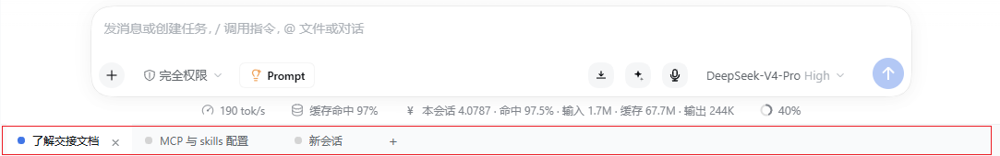

<h1 align="center">🗂️ dsh-bottom-tabs</h1>

<p align="center"><b>Browser-style session tabs for the DeepSeek Harness Web UI.</b></p>

<p align="center">
  Sessions side by side · upside-down tabs along the bottom edge · status at a glance
</p>

<p align="center">
  <a href="./README.md">简体中文</a> · <a href="./README.en.md">English</a>
</p>

<p align="center">
  <a href="./LICENSE"></a>
  
  
</p>

> 💡 **What it solves.** Once the sidebar holds a pile of sessions, switching between them means scrolling a list. This strip puts the sessions you are using or keep coming back to side by side at the **bottom** of the window, so you switch with a click — like a browser or VS Code.

<p align="center">
  
</p>

***

## ✨ Features

<table>
<tr><th align="center" width="130">Module</th><th align="left">What it does</th></tr>
<tr>
<td align="center">🗂️<br/><b>Session tabs</b></td>
<td>One tab per <strong>real session</strong>. Click to switch; the active tab gets a blue dot and a solid background that "grows into" the page above.</td>
</tr>
<tr>
<td align="center">➕<br/><b>New tab</b></td>
<td>Click the <code>+</code> icon to open a new session in the current workspace; the new session <strong>automatically</strong> becomes a tab.</td>
</tr>
<tr>
<td align="center">✖️<br/><b>Close tab</b></td>
<td>Click <code>×</code> or <strong>middle-click</strong> to take a tab out of the strip. The tab only — the session is <strong>not archived</strong> and stays in the sidebar. Closing the active tab switches to its neighbour automatically.</td>
</tr>
<tr>
<td align="center">↔️<br/><b>Drag to reorder</b></td>
<td>Press and drag any tab left or right; the other tabs <strong>move aside live</strong> as the pointer passes, and the new order is cached immediately. Dropping on empty space moves the tab to the far right.</td>
</tr>
<tr>
<td align="center">🖱️<br/><b>Add from menu</b></td>
<td>Right-click any session in the sidebar → <strong>Add to tab</strong>. The item is greyed out for sessions already in the strip.</td>
</tr>
<tr>
<td align="center">💾<br/><b>Persistence</b></td>
<td>Tab order and cached titles live in <code>localStorage</code>, so they survive a page reload or a GUI restart.</td>
</tr>
<tr>
<td align="center">🪶<br/><b>Lightweight</b></td>
<td>Client-side only, a single <code>client.js</code>: no host services, no network, no file writes.</td>
</tr>
</table>

## 🚀 Install

Requires DeepSeek Harness (desktop app or Web UI). The strip lives in the Web UI, independent of the DSH version installed.

```
# install from npm (recommended)
plugin_manager install_bundle dsh-bottom-tabs

# install from a local path (when editing the code)
plugin_manager install_bundle E:\path\to\dsh-bottom-tabs

# uninstall
plugin_manager remove_bundle dsh-bottom-tabs
```

Package page: <https://www.npmjs.com/package/dsh-bottom-tabs>. Then reload the Web UI (Ctrl+R). For development, linking the repository path into the profile works the same way — edit and refresh.

> Do not hand-edit the profile's `package.json`: the plugin manager maintains both `dependencies` and `dsh.profile.bundles`. Editing one of them by hand usually means the plugin either does not load or loads twice.

## 📖 Usage

1. **First run**: the strip seeds itself with your current session, so it is never empty.
2. **Switch**: click a tab to jump to that session — the same as clicking it in the sidebar.
3. **New**: `+` starts a new session (same as the sidebar's "New session") and appends it as a tab.
4. **Close**: `×` or middle-click. It only leaves the strip; the session is untouched and can be added back from the context menu.
5. **Add existing**: right-click a sidebar session → "Add to tab".
6. **Reorder**: drag a tab left or right; it moves into place while you drag, and the order is remembered.

### Status dots

| Dot | Meaning |
|---|---|
| 🔵 Blue | The session currently on screen |
| 🟢 Green | Not current, finished, and you have not looked at it yet (`completionUnread`) |
| ⚪ Grey + blue breathing ring | Not current, currently thinking / running |
| ⚪ Grey | Plain tab, nothing new |

> Priority: current > unread > thinking > idle. The current session never pulses while thinking — the conversation area itself already gives that feedback.

## 🧩 Compatibility

- The DeepSeek Harness Web UI (the Web view embedded in the desktop window, or the same UI opened directly in a browser).
- Chromium-based browsers (Chrome / Edge). Tab state is stored in `localStorage` per UI origin, so changing port or token does not lose it on the same origin.
- No host-side services required. Where `contextMenus` is unavailable the context-menu entry is simply absent and the strip keeps working.

## 🛠️ Development

```sh
# No build step: the repository itself is the installable bundle
# edit client.js → reload the page (Ctrl+R) and it takes effect
```

- Layout: `client.js` (all front-end logic) · `index.js` (empty host entry) · `cordis.patch.yml` (bundle mount) · `locale/*.json` (plugin metadata strings).
- Debug: `[session-tabs]` lines in the DSH Web console; tab state in `localStorage['dsh.session-tabs.v1']`.
- Tunables: CSS variables `--dsst-height` (36px) / `--dsst-tab-min` (56px) / `--dsst-tab-max` (200px) / `--dsst-pulse` (1.4s).

## 📄 License

[MIT](./LICENSE)

***

## ⭐ Support

If this is useful, give it a **Star ⭐**. Ideas and bug reports are welcome as Issues / PRs.
