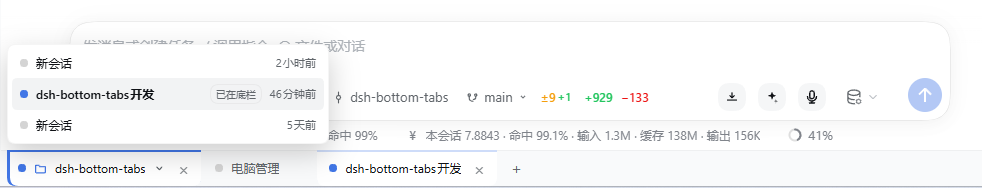

<h1 align="center">🗂️ dsh-bottom-tabs</h1>

<p align="center"><b>A browser-style session tab strip for the DeepSeek Harness Web UI.</b></p>

<p align="center">
  Sessions and workspaces side by side · one click to unfold a workspace · status at a glance
</p>

<p align="center">
  <a href="./README.en.md">English</a> · <a href="./README.md">简体中文</a>
</p>

<p align="center">
  <a href="./LICENSE"></a>
  
  
</p>

> 💡 **What problem does it solve?** When the sidebar holds a lot of sessions, switching means scrolling a list. The tab strip pins the sessions you are using or keep coming back to side by side at the **bottom** of the window, so you switch with a click — like a browser or VS Code.

<p align="center">
  
</p>

***

## ✨ Features

<table>
<tr><th align="center" width="130">Module</th><th align="left">What it does</th></tr>
<tr>
<td align="center">➕<br/><b>New tab</b></td>
<td>Click the <code>“+”</code> button to open a new session in the current workspace; the new session becomes a tab <strong>automatically</strong>.</td>
</tr>
<tr>
<td align="center">✖️<br/><b>Close tab</b></td>
<td>Click <code>×</code> or <strong>middle-click</strong> to take a tab out of the strip. The tab only — the session is <strong>not archived</strong> and stays in the sidebar.</td>
</tr>
<tr>
<td align="center">↔️<br/><b>Reorder</b></td>
<td>Drag any tab left or right; the other tabs make room <strong>as you drag</strong>, and the new order is written to storage immediately. Dropping on empty space moves it to the far right.</td>
</tr>
<tr>
<td align="center">🖱️<br/><b>Right-click to add</b></td>
<td>Right-click any session in the sidebar → <strong>Add to tab strip</strong>. The item is greyed out for sessions already in the strip.</td>
</tr>
<tr>
<td align="center">📁<br/><b>Workspace tabs</b></td>
<td>Right-click any <strong>workspace</strong> in the sidebar → <strong>Add to tab strip</strong>. A workspace tab carries a folder glyph and a <code>⌄</code> chevron, so it never reads as a session tab.</td>
</tr>
<tr>
<td align="center">💾<br/><b>Persistence</b></td>
<td>Tab order, cached titles and each workspace's last active session live in <code>localStorage</code>, so they survive a page reload or a GUI restart.</td>
</tr>
<tr>
<td align="center">🪶<br/><b>Lightweight</b></td>
<td>Pure client-side plugin in a single <code>client.js</code>; registers no host service, makes no network calls, writes no files.</td>
</tr>
</table>

## 🚀 Install

Requires the DeepSeek Harness desktop app or Web UI (the strip lives in the Web interface and does not depend on your local DSH version).

```
# Install from npm (recommended)
plugin_manager install_bundle dsh-bottom-tabs

# Install from a local path (while editing the code)
plugin_manager install_bundle E:\path\to\dsh-bottom-tabs

# Uninstall
plugin_manager remove_bundle dsh-bottom-tabs
```

npm page: <https://www.npmjs.com/package/dsh-bottom-tabs>. Refresh the Web UI afterwards (Ctrl+R). During development, `link`-ing the repository path into the profile has the same effect — refresh to pick up changes.

> Don't hand-edit the profile's `package.json`: the plugin manager maintains both `dependencies` and `dsh.profile.bundles`, and a partial manual edit easily leaves the plugin unloaded or loaded twice.

## 📖 Usage

1. **First open**: the strip seeds one tab from the current session, so it is never empty.
2. **Switch**: click a tab to jump to that session — the same as clicking it in the sidebar.
3. **New**: "+" creates a new session (same as the sidebar's "New session") and appends it as a tab.
4. **Close**: `×` or middle-click; the tab leaves the strip, the session is untouched and can be added back from the context menu.
5. **Add existing**: right-click a sidebar session → "Add to tab strip".
6. **Reorder**: drag a tab left or right; the order is remembered.
7. **Workspace tabs**: right-click a workspace in the sidebar → "Add to tab strip".

## 🆕 Recent updates

### v0.2.0 — workspace tabs

- Right-clicking a workspace in the sidebar now offers **Add to tab strip**.
- The popover shows status dots, relative time and an "in tab strip" badge, and leaves archived sessions out; clicking outside, `Esc`, scrolling or resizing collapses it.

### v0.1.1 / v0.1.0

- Bottom session tab strip: new tab, close (`×` / middle-click), drag to reorder, status dots, `localStorage` persistence.

Full history in [CHANGELOG.md](./CHANGELOG.md) (Chinese).

### Status dots

| Dot | Meaning |
|---|---|
| 🔵 Blue | The session currently on screen |
| 🟢 Green | Not current, thinking finished but you have not looked yet (`completionUnread`) |
| ⚪ Grey + blue breathing ring | Not current, thinking / running |
| ⚪ Grey | Plain tab, nothing new |

> Priority: current > unread > thinking > plain. The current session does not pulse even while thinking — the conversation area already shows that.

## 🧩 Compatibility

- The DeepSeek Harness Web UI (the Web view embedded in the desktop window, or a browser pointed at it).
- Chromium-based browsers (Chrome / Edge). Tab state is stored per UI origin in `localStorage`, so a port or token change does not affect the same origin's data.
- No host-side service required; where the `contextMenus` service is missing, the menu entries simply do not appear and the strip keeps working.

## 🛠️ Development

```sh
# No build step: the repository itself is an installable bundle
# Edit client.js → refresh the page (Ctrl+R) to apply
```

- Repository layout: `client.js` (all front-end logic) · `index.js` (empty host entry) · `cordis.patch.yml` (bundle mount) · `locale/*.json` (plugin metadata strings).
- Debugging: watch for the `[session-tabs]` prefix in the DSH Web console; tab state lives in `localStorage['dsh.session-tabs.v1']` with the shape `{ v: 2, order: [{ k: 's' | 'w', id }], titles, wsTitles, wsLast }`.
- Backward compatibility: the `v1`-era `order: string[]` is normalized into session entries on read, and the **key name never changes**; the first write back after upgrading copies the original value verbatim to `dsh.session-tabs.v1.bak` (once, for manual recovery). An older plugin reading the new data degrades to session-only tabs and loses no configuration.
- Tunables: CSS variables `--dsst-height` (36px) / `--dsst-tab-min` (56px) / `--dsst-tab-max` (200px) / `--dsst-pulse` (1.4s).

## 📄 License

[MIT](./LICENSE)

***

## ⭐ Support

If it helps, drop a **Star ⭐**; ideas and issues are welcome as Issue / PR.
