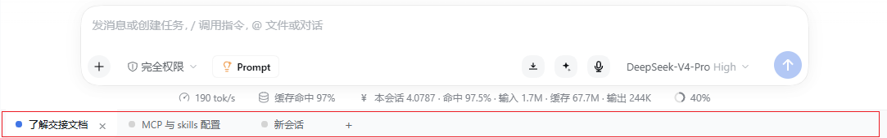

<h1 align="center">🗂️ dsh-bottom-tabs</h1>

<p align="center"><b>给 DeepSeek Harness Web UI 一条浏览器风格的会话标签栏。</b></p>

<p align="center">
  多个会话并列切换 · 底栏倒挂页签 · 状态一眼可见
</p>

<p align="center">
  <a href="./README.en.md">English</a> · <a href="./README.md">简体中文</a>
</p>

<p align="center">
  <a href="./LICENSE"></a>
  
  
</p>

> 💡 **它解决什么？** 左侧栏会话比较多的时候，切换会话，需要翻列表。标签栏把多个在用或常用会话并排挂在窗口**底部**，像浏览器或 VS Code 一样点击切换。

<p align="center">
  
</p>

***

## ✨ 功能

<table>
<tr><th align="center" width="130">模块</th><th align="left">说明</th></tr>
<tr>
<td align="center">🗂️<br/><b>会话标签</b></td>
<td>底部一条标签栏，每个标签是一个<strong>真实会话</strong>；点一下即切换，当前标签蓝点 + 白底"长进"页面里。</td>
</tr>
<tr>
<td align="center">➕<br/><b>新建标签</b></td>
<td>点击<code>“+”</code>图标按钮，在当前工作区自动打开新会话，新会话创建后<strong>自动</strong>成为一个标签。</td>
</tr>
<tr>
<td align="center">✖️<br/><b>关闭标签</b></td>
<td>点击<code>×</code> 或<strong>鼠标中键</strong>把标签移出标签栏；只关标签、<strong>不归档会话</strong>，侧栏里它还在。关掉当前标签时自动切到相邻的一个。</td>
</tr>
<tr>
<td align="center">↔️<br/><b>拖拽排序</b></td>
<td>按住任意标签左右拖动即可调整顺序，指针经过时其他标签<strong>实时让位</strong>；新顺序立即写入缓存。拖到空白处会移到最右侧。</td>
</tr>
<tr>
<td align="center">🖱️<br/><b>右键添加</b></td>
<td>侧栏任意会话右键 →「<strong>添加到 Tab</strong>」；已在标签栏中的会话该项<strong>置灰</strong>。</td>
</tr>
<tr>
<td align="center">💾<br/><b>持久化</b></td>
<td>标签顺序与标题缓存在 <code>localStorage</code>，刷新页面、重启 GUI 后都还在。</td>
</tr>
<tr>
<td align="center">🪶<br/><b>轻量</b></td>
<td>纯客户端插件，单个 <code>client.js</code>；不注册宿主服务、不联网、不写文件。</td>
</tr>
</table>

## 🚀 安装

前置：DeepSeek Harness 桌面端或 Web UI（标签栏挂在 Web 界面，与本机 DSH 版本无关）。

```
# 从 npm 安装（推荐）
plugin_manager install_bundle dsh-bottom-tabs

# 从本地路径安装（改代码时用）
plugin_manager install_bundle E:\path\to\dsh-bottom-tabs

# 卸载
plugin_manager remove_bundle dsh-bottom-tabs
```

npm 包页：<https://www.npmjs.com/package/dsh-bottom-tabs>。装完刷新 Web UI（Ctrl+R）。开发时把仓库路径 `link` 进 profile 也是一样的效果，改完刷新即可。

> 别手改 profile 的 `package.json`：插件管理器会同时维护 `dependencies` 与 `dsh.profile.bundles`，手改很容易只改到一半，导致插件不加载或加载两次。

## 📖 使用

1. **首次打开**：标签栏用当前会话自动播种一个标签，不会空着。
2. **切换**：点标签即可跳到该会话，等于侧栏里点它一下。
3. **新建**：「+」创建新会话（同侧栏「新会话」），创建完自动追加成标签。
4. **关闭**：`×` 或中键；只从标签栏移除，会话本身不受影响，还能从右键菜单加回来。
5. **添加已有会话**：侧栏会话右键 →「添加到 Tab」。
6. **排序**：直接拖标签左右移动，松手前就能看到位置；顺序会被记住。

### 圆点含义

| 圆点 | 含义 |
|---|---|
| 🔵 蓝点 | 当前正在显示的会话 |
| 🟢 绿点 | 非当前会话，思考已完成但你还没看（`completionUnread`） |
| ⚪ 灰点 + 蓝描边呼吸光圈 | 非当前会话，正在思考 / 执行中 |
| ⚪ 灰点 | 普通标签，无新动静 |

> 优先级：当前 > 未读 > 思考中 > 普通。当前会话即使在思考也不脉动——对话区本身已经给了反馈。

## 🧩 兼容性

- DeepSeek Harness 的 Web UI（桌面端窗口内嵌的 Web 视图，或浏览器直接访问）。
- Chromium 内核浏览器（Chrome / Edge）；标签状态按 UI 源站存在 `localStorage`，换端口或换 token 不影响同一源站的数据。
- 不依赖 Host 侧服务；没有 `contextMenus` 服务的环境里，右键菜单项自动缺席，标签栏照常工作。

## 🛠️ 开发

```sh
# 无需构建：仓库本身就是可安装的 bundle
# 改 client.js → 刷新页面（Ctrl+R）即生效
```

- 仓库结构：`client.js`（全部前端逻辑）· `index.js`（空宿主入口）· `cordis.patch.yml`（bundle 挂载）· `locale/*.json`（插件元信息文案）。
- 调试：DSH Web 控制台看 `[session-tabs]` 前缀日志；标签状态在 `localStorage['dsh.session-tabs.v1']`。
- 可调项：CSS 变量 `--dsst-height`(36px) / `--dsst-tab-min`(56px) / `--dsst-tab-max`(200px) / `--dsst-pulse`(1.4s)。

## 📄 License

[MIT](./LICENSE)

***

## ⭐ 支持

觉得好用就点个 **Star ⭐**；有想法或遇到问题，欢迎提 Issue / PR。
